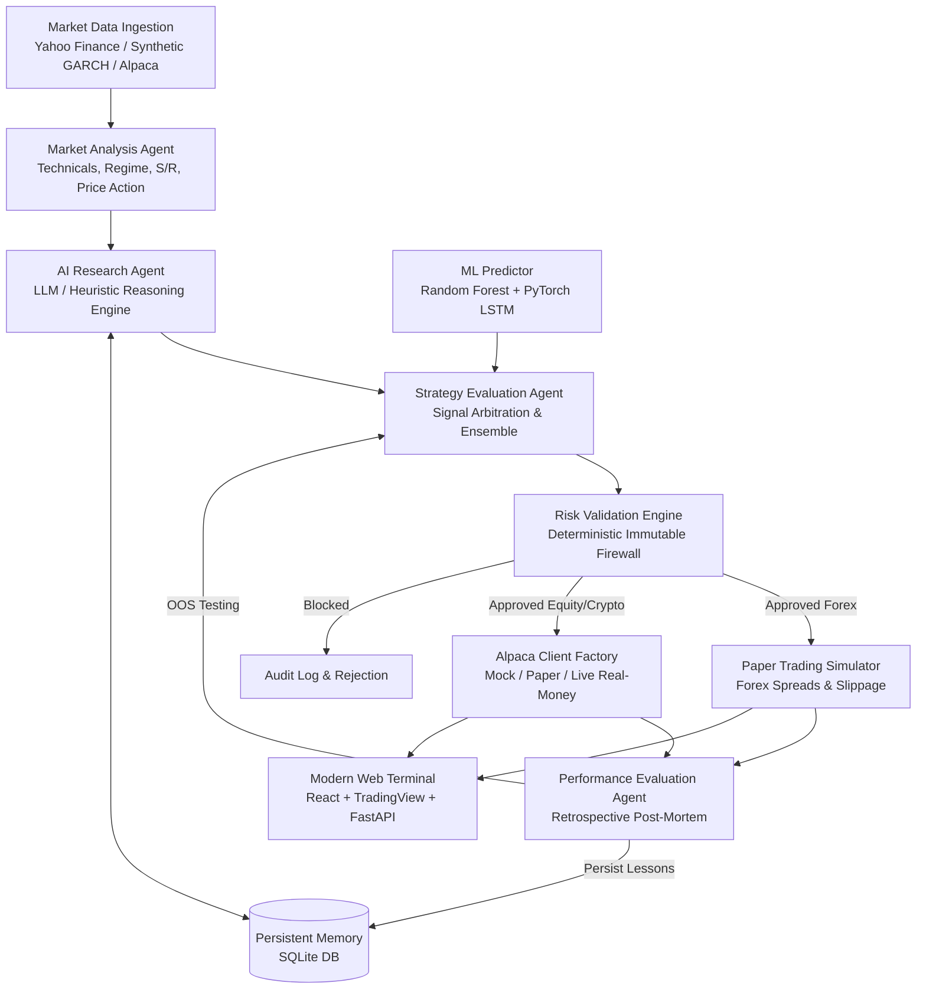

# 🤖 Autonomous AI Trading Bot (Multi-Agent Forex & Alpaca Live Trading)

An institutional-grade, autonomous algorithmic trading system inspired by modern AI trading-agent architectures. The system deploys specialized autonomous agents to analyze Forex, US Equity, and Cryptocurrency markets, develop trading hypotheses, evaluate opportunities, execute paper or live real-money trades, evaluate its own decisions retrospectively, and store permanent lessons in persistent SQLite memory.

---

## ⚡ Execution Environments & Real-Money Trading

The bot supports 3 execution environments via a unified broker abstraction layer (`AlpacaClientInterface`):

| Environment | Mode | Broker Endpoint | Capital at Risk | Safety Requirement |
| :--- | :--- | :--- | :--- | :--- |
| **Offline Sandbox** | `MOCK` | Local Matching Engine | Virtual ($0 risk) | Default offline sandbox |
| **Alpaca Paper** | `PAPER` | `https://paper-api.alpaca.markets` | Virtual ($0 risk) | `ALPACA_API_KEY` & `ALPACA_SECRET_KEY` |
| **Alpaca Live Real-Money** | `LIVE` | `https://api.alpaca.markets` | **REAL MONEY** | `CONFIRM_REAL_MONEY_TRADING=TRUE` |

> [!CAUTION]
> **REAL-MONEY TRADING SAFETY SAFEGUARD**:
> When `TRADING_MODE=LIVE`, the bot connects directly to **Alpaca Securities Live REST API**. To prevent accidental capital exposure, real-money execution is protected by an **immutable safety tripwire**: orders are strictly blocked unless `CONFIRM_REAL_MONEY_TRADING=TRUE` is explicitly configured. All orders are subject to the deterministic Risk Firewall (`MAX_ORDER_USD` cap, daily drawdown halt, and instant Emergency Flatten / Kill Switch).

---

## 🏛️ System Architecture



### Specialized Agents & Modules

1. **Market Analysis Agent (`agents/market_agent.py`)**
   - Vectorized computation of technical indicators: RSI (14), MACD, EMAs (9, 21, 50, 200), SMAs, Bollinger Bands, and ATR.
   - Price-action pattern recognition (Bullish/Bearish Engulfing, Pin Bars, Hammers, Dojis, Inside Bars).
   - Volatility regime classification (`HIGH_VOLATILITY`, `NORMAL`, `COMPRESSED`).

2. **AI Research Agent (`agents/research_agent.py`)**
   - Formulates grounded trading hypotheses with explicit rationale and invalidation criteria.
   - Grounded strictly in verified numbers: **never hallucinates prices or claims certainty**.
   - Retrieves relevant past mistakes and lessons from persistent memory for the current regime and pair before forming ideas.

3. **Strategy Evaluation Agent (`agents/strategy_agent.py`)**
   - Synthesizes technical indicators, LLM research hypotheses, and machine learning models.
   - ML Ensemble: Combines non-linear **Random Forest** (feature importances) and sequential deep **PyTorch LSTM**.
   - Resolves cross-model contradictions (e.g. if research proposes BUY but ML predicts DOWN > 55%, the agent downgrades to HOLD).
   - Enforces a minimum 1:1.5 Risk-to-Reward ratio.

4. **Risk Validation Engine (`core/risk_manager.py`)**
   - **The Immutable Firewall**: Mathematical boundaries that neither the user nor the AI can bypass.
   - Enforces maximum risk per trade (default 1.5%, hard cap 2.5% of equity).
   - Maximum daily drawdown cutoff (3.5% daily stop) and total drawdown ceiling (8.0%).
   - Dynamic lot sizing based on stop-loss pip distance, pip value, and current equity.
   - Real-money dollar cap enforcement (`MAX_ORDER_USD`).
   - One-click Emergency Kill Switch halting all order processing.

5. **Live & Paper Broker Execution (`core/alpaca_live_client.py` & `core/alpaca_factory.py`)**
   - Direct integration with Alpaca REST v2 API (Accounts, Orders, Positions, Clock, Assets).
   - Dynamic routing to Paper or Live Real-Money matching engines.
   - Emergency panic liquidation (`close_all_positions(cancel_orders=True)`).
   - SQLite persistence of executed orders and positions.

6. **Paper Trading Simulator (`core/paper_trader.py`)**
   - Realistic Forex simulation with virtual balance, spreads, slippage, and margins.
   - Real-time candle evaluation: automatically executes Stop-Loss and Take-Profit fills.

7. **Performance Evaluation Agent (`agents/evaluation_agent.py`)**
   - Post-trade retrospective evaluation: compares prediction direction against realized price movement.
   - Categorizes mistakes (e.g. volatility whipsaw, false breakout in compressed regime, counter-trend entry).
   - Formulates concrete lessons and stores them into persistent SQLite memory.

8. **Persistent Memory Agent (`agents/memory_agent.py` & `database/memory.py`)**
   - High-concurrency SQLite database with Write-Ahead Logging (WAL).
   - Tables: `hypotheses`, `predictions`, `trades`, `lessons_learned`, `alpaca_mock_orders`, and `agent_logs`.

---

## 💱 Supported Instruments

* **Forex Currency Pairs**: EUR/USD, GBP/USD, USD/JPY, AUD/USD, USD/CAD
* **Alpaca US Equities & ETFs**: AAPL, MSFT, NVDA, TSLA, SPY, QQQ
* **Alpaca Cryptocurrencies**: BTC/USD, ETH/USD

---

## 🚀 Quickstart & Installation

### 1. Requirements & Setup
The project is verified and fully compatible with **Python 3.10 through Python 3.13** and **Node.js v20+**.

```bash
pip install -r requirements.txt
```

### 2. Launch the Modern Web Terminal (Recommended)
Launch the unified high-performance FastAPI server and React frontend:

```bash
python server.py
```
Open **[http://localhost:8000](http://localhost:8000)** in your browser.

* Instant TradingView Lightweight Candlestick Charts (OHLC, EMA 9/21/50, Volume).
* Live WebSocket tick stream & autonomous agent cycle execution with zero page reloads.
* Dual-Engine Portfolio Hub (Forex virtual lots + Alpaca simulated shares).
* High-contrast institutional dark aesthetic following UI/UX Pro Max standards.

### 3. (Alternative) Launch the Streamlit Dashboard
```bash
python -m streamlit run app.py
```
Open **[http://localhost:8501](http://localhost:8501)** in your browser.

---

## 🧪 Testing Coverage

The `tests/` directory includes 39 automated unit and integration tests covering:
- `test_live_alpaca_client.py`: Live and paper endpoint routing, real-money confirmation safety locks, kill switch trips, dollar cap enforcement, REST v2 schema parsing, panic emergency flatten, and client factory.
- `test_indicators.py`: RSI Wilder smoothing, MACD convergence, Bollinger Band envelopes, ATR.
- `test_risk_manager.py`: Lot sizing, RR rejection, drawdown ceiling trips, duplicate order prevention.
- `test_paper_trader.py`: Margin calculations, spread costs, take-profit spikes, stop-loss cuts.
- `test_prediction.py`: Feature stationary pipeline, Random Forest training, PyTorch LSTM inference.
- `test_agent_workflow.py`: Complete end-to-end multi-agent autonomous cycle.
- `test_alpaca_integration.py`: Modular interface compliance, mock account, simulated execution, limit orders, asset class separation, market data abstraction, secret hygiene, and SQLite persistence.
- `test_audit_suite.py`: Continuous market monitoring lifecycle, retrospective evaluation, and persistent SQLite memory.

Run the test suite anytime with:
```bash
python -m pytest -v tests/
```
