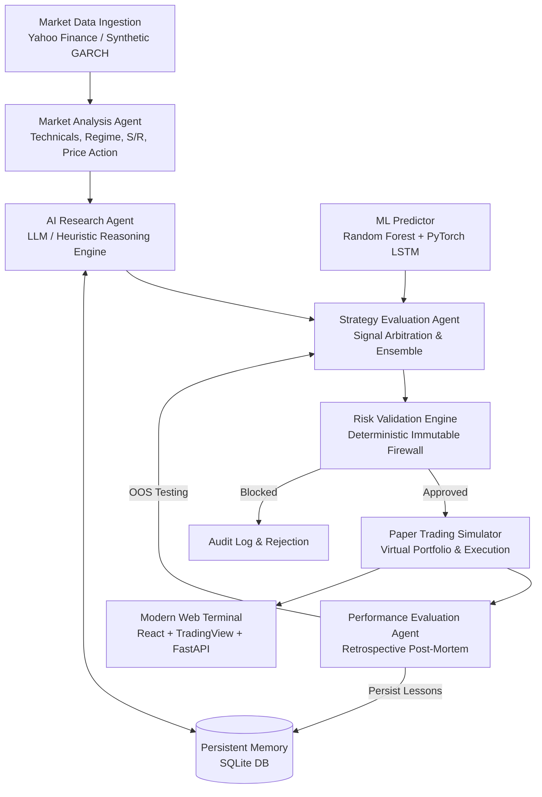

# 🤖 Autonomous AI Trading Bot (Multi-Agent Forex & Alpaca Simulation)

An institutional-grade, autonomous algorithmic trading system inspired by modern AI trading-agent architectures. The system deploys specialized autonomous agents to analyze Forex and equity markets, develop trading hypotheses, evaluate opportunities, execute simulated paper trades, evaluate its own decisions retrospectively, and store permanent lessons in persistent SQLite memory.

> **IMPORTANT**: This bot operates strictly in **Paper-Trading Mode**. It simulates realistic execution with virtual capital, spreads, slippage, and margins. It does **not** connect to real-money accounts or execute live broker orders. All broker connectivity is permanently disabled.

---

## 🏛️ System Architecture



### Specialized Agents & Modules

1. **Market Analysis Agent (`agents/market_agent.py`)**
   - Vectorized computation of technical indicators: RSI (14), MACD, EMAs (9, 21, 50, 200), SMAs, Bollinger Bands, and ATR.
   - Price-action pattern recognition (Bullish/Bearish Engulfing, Pin Bars, Hammers, Dojis, Inside Bars).
   - Volatility regime classification (`HIGH_VOLATILITY`, `NORMAL`, `COMPRESSED`).

2. **AI Research Agent (`agents/research_agent.py`)**
   - Formulates grounded trading hypotheses with explicit rationale and invalidation criteria.
   - Grounded strictly in verified numbers: **never hallucinates prices or claims certainty**.
   - Retrieves relevant past mistakes and lessons from persistent memory for the current regime and pair before forming ideas.

3. **Strategy Evaluation Agent (`agents/strategy_agent.py`)**
   - Synthesizes technical indicators, LLM research hypotheses, and machine learning models.
   - ML Ensemble: Combines non-linear **Random Forest** (feature importances) and sequential deep **PyTorch LSTM**.
   - Resolves cross-model contradictions (e.g. if research proposes BUY but ML predicts DOWN > 55%, the agent downgrades to HOLD).
   - Enforces a minimum 1:1.5 Risk-to-Reward ratio.

4. **Risk Validation Engine (`core/risk_manager.py`)**
   - **The Immutable Firewall**: Mathematical boundaries that neither the user nor the AI can bypass.
   - Enforces maximum risk per trade (default 1.5%, hard cap 2.5% of equity).
   - Maximum daily drawdown cutoff (3.5% daily stop) and total drawdown ceiling (8.0%).
   - Dynamic lot sizing based on stop-loss pip distance, pip value, and current equity.

5. **Paper Trading Simulator (`core/paper_trader.py`)**
   - Virtual account balance ($10,000 default).
   - Models realistic Forex spreads and adverse execution slippage.
   - Real-time candle evaluation: automatically executes Stop-Loss and Take-Profit fills on high/low price action.

6. **Performance Evaluation Agent (`agents/evaluation_agent.py`)**
   - Post-trade retrospective evaluation: compares prediction direction against realized price movement.
   - Categorizes mistakes (e.g. volatility whipsaw, false breakout in compressed regime, counter-trend entry).
   - Formulates concrete lessons and stores them into persistent SQLite memory.

7. **Persistent Memory Agent (`agents/memory_agent.py` & `database/memory.py`)**
   - High-concurrency SQLite database with Write-Ahead Logging (WAL).
   - Tables: `hypotheses`, `predictions`, `trades`, `lessons_learned`, `strategy_evaluations`, and `agent_logs`.

8. **Modular Alpaca-Compatible Architecture (`core/alpaca_mock_client.py` & `core/alpaca_interface.py`)**
   - **Educational Architecture**: Conforms strictly to Alpaca REST v2 API specification (Accounts, Orders, Positions, Clock, Assets).
   - **Hardcoded Broker Connectivity Disabling**: All live network connectivity to external brokers is strictly disabled (`broker_connectivity_enabled = False`).
   - **Offline Mock Execution**: Simulated matching engine fills Market, Limit, and Stop orders against local market data with realistic slippage.
   - **Asset Class Separation**: Explicit boundary separating Forex currency pairs from Alpaca assets (US Equities & Crypto in shares/units).

---

## 💱 Supported Instruments

* **Forex Currency Pairs**: EUR/USD, GBP/USD, USD/JPY, AUD/USD, USD/CAD
* **Alpaca US Equities & ETFs**: AAPL, MSFT, NVDA, TSLA, SPY, QQQ
* **Alpaca Cryptocurrencies**: BTC/USD, ETH/USD

---

## 🚀 Quickstart & Installation

### 1. Requirements & Setup
The project is verified and fully compatible with **Python 3.10 through Python 3.13** and **Node.js v20+**.

```bash
pip install -r requirements.txt
```

### 2. Launch the Modern Web Terminal (Recommended)
Launch the unified high-performance FastAPI server and React frontend:

```bash
python server.py
```
Open **[http://localhost:8000](http://localhost:8000)** in your browser.

* Instant TradingView Lightweight Candlestick Charts (OHLC, EMA 9/21/50, Volume).
* Live WebSocket tick stream & autonomous agent cycle execution with zero page reloads.
* Dual-Engine Portfolio Hub (Forex virtual lots + Alpaca simulated shares).
* High-contrast institutional dark aesthetic following UI/UX Pro Max standards.

### 3. (Alternative) Launch the Streamlit Dashboard
```bash
python -m streamlit run app.py
```
Open **[http://localhost:8501](http://localhost:8501)** in your browser.

---

## 🧪 Testing Coverage

The `tests/` directory includes 25 automated unit and integration tests covering:
- `test_indicators.py`: RSI Wilder smoothing, MACD convergence, Bollinger Band envelopes, ATR.
- `test_risk_manager.py`: Lot sizing, RR rejection, drawdown ceiling trips, duplicate order prevention.
- `test_paper_trader.py`: Margin calculations, spread costs, take-profit spikes, stop-loss cuts.
- `test_prediction.py`: Feature stationary pipeline, Random Forest training, PyTorch LSTM inference.
- `test_agent_workflow.py`: Complete end-to-end multi-agent autonomous cycle.
- `test_alpaca_integration.py`: Modular interface compliance, connectivity disabled safeguards, mock account, simulated execution, limit orders, asset class separation, market data abstraction, secret hygiene, and SQLite persistence.

Run the full suite anytime with:
```bash
python -m pytest -v tests/
```
