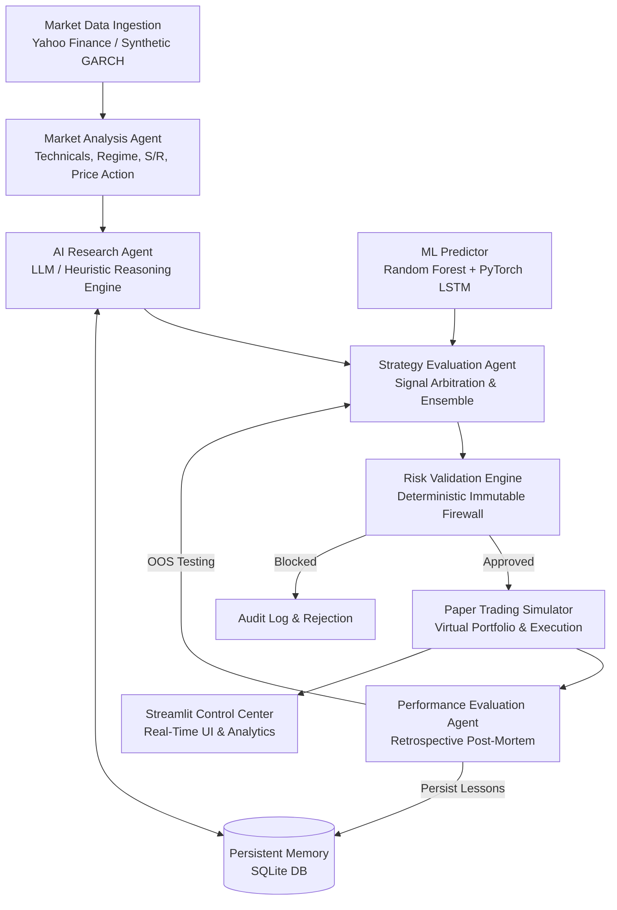

# 🤖 Autonomous AI Trading Bot (Multi-Agent Forex System)

An institutional-grade, autonomous algorithmic trading system inspired by modern AI trading-agent architectures. The system deploys specialized autonomous agents to analyze Forex markets, develop trading hypotheses, evaluate opportunities, execute simulated paper trades, evaluate its own decisions retrospectively, and store permanent lessons in persistent SQLite memory.

> **IMPORTANT**: This bot operates strictly in **Paper-Trading Mode**. It simulates realistic execution with virtual capital, spreads, slippage, and margins. It does **not** connect to real-money accounts or execute live broker orders.

---

## 🏛️ System Architecture



### Specialized Agents & Modules

1. **Market Analysis Agent (`agents/market_agent.py`)**
   - Vectorized computation of technical indicators: RSI (14), MACD, EMAs (9, 21, 50, 200), SMAs, Bollinger Bands, and ATR.
   - Price-action pattern recognition (Bullish/Bearish Engulfing, Pin Bars, Hammers, Dojis, Inside Bars).
   - Volatility regime classification (`HIGH_VOLATILITY`, `NORMAL`, `COMPRESSED`).
   - Statistical properties: return skewness, kurtosis, and annualized volatility.

2. **AI Research Agent (`agents/research_agent.py`)**
   - Formulates grounded trading hypotheses with explicit rationale and invalidation criteria.
   - Grounded strictly in verified numbers: **never hallucinates prices or claims certainty**.
   - Retrieves relevant past mistakes and lessons from persistent memory for the current regime and pair before forming ideas.
   - Configurable LLM API integration: Google Gemini, OpenAI, local Ollama, or deterministic quantitative reasoning fallback.

3. **Strategy Evaluation Agent (`agents/strategy_agent.py`)**
   - Synthesizes technical indicators, LLM research hypotheses, and machine learning models.
   - ML Ensemble: Combines non-linear **Random Forest** (feature importances) and sequential deep **PyTorch LSTM**.
   - Resolves cross-model contradictions (e.g. if research proposes BUY but ML predicts DOWN > 55%, the agent downgrades to HOLD).
   - Enforces a minimum 1:1.5 Risk-to-Reward ratio.

4. **Risk Validation Engine (`core/risk_manager.py`)**
   - **The Immutable Firewall**: Mathematical boundaries that neither the user nor the AI can bypass.
   - Enforces maximum risk per trade (default 1.5%, hard cap 2.5% of equity).
   - Maximum daily drawdown cutoff (3.5% daily stop) and total drawdown ceiling (8.0%).
   - Dynamic lot sizing based on stop-loss pip distance, pip value, and current equity.
   - Maximum open positions ceiling (default 3, hard cap 5) and currency exposure limits.

5. **Paper Trading Simulator (`core/paper_trader.py`)**
   - Virtual account balance ($10,000 default).
   - Models realistic Forex spreads and adverse execution slippage.
   - Real-time candle evaluation: automatically executes Stop-Loss and Take-Profit fills on high/low price action.
   - Portfolio tracking: Margin Used, Free Margin, Unrealized PnL, Realized PnL, Max Drawdown, Sharpe Ratio, Profit Factor, and Win Rate.

6. **Performance Evaluation Agent (`agents/evaluation_agent.py`)**
   - Post-trade retrospective evaluation: compares prediction direction against realized price movement.
   - Categorizes mistakes (e.g. volatility whipsaw, false breakout in compressed regime, counter-trend entry).
   - Formulates concrete lessons and stores them into persistent SQLite memory.
   - Executes chronological out-of-sample (OOS) strategy backtests to validate experimental parameter changes.

7. **Persistent Memory Agent (`agents/memory_agent.py` & `database/memory.py`)**
   - High-concurrency SQLite database with Write-Ahead Logging (WAL).
   - Tables: `hypotheses`, `predictions`, `trades`, `lessons_learned`, `strategy_evaluations`, and `agent_logs`.
   - Contextual retrieval: queries previous lessons matching specific pairs and regimes.

8. **Modular Alpaca-Compatible Architecture (`core/alpaca_mock_client.py` & `core/alpaca_interface.py`)**
   - **Educational Architecture**: Conforms strictly to Alpaca REST v2 API specification (Accounts, Orders, Positions, Clock, Assets).
   - **Hardcoded Broker Connectivity Disabling**: All live network connectivity to external brokers is strictly disabled (`broker_connectivity_enabled = False`).
   - **Offline Mock Execution**: Simulated matching engine fills Market, Limit, and Stop orders against local market data with realistic slippage.
   - **Asset Class Separation**: Explicit boundary separating Forex currency pairs (lots, pips, leverage) from Alpaca assets (US Equities & Crypto in shares/units).
   - **Market Data Abstraction & Provenance**: Explicit badges distinguishing `[MOCK ALPACA DATA]`, `[REAL HISTORICAL / DELAYED DATA]`, and `[SYNTHETIC OFFLINE GARCH DATA]`.
   - **Zero Hardcoded Secrets**: API credentials load exclusively via environment variables (`ALPACA_API_KEY`, `ALPACA_SECRET_KEY`) with empty defaults.

---

## 💱 Supported Forex Currency Pairs

- **EUR/USD**: Euro / US Dollar
- **GBP/USD**: British Pound / US Dollar
- **USD/JPY**: US Dollar / Japanese Yen
- **AUD/USD**: Australian Dollar / US Dollar
- **USD/CAD**: US Dollar / Canadian Dollar

---

## 🚀 Quickstart & Installation

### 1. Requirements & Environment
The bot is verified and fully compatible with **Python 3.10 through Python 3.13**.

```bash
pip install -r requirements.txt
```

### 2. Run the Unit Test Suite
Execute the comprehensive test suite verifying indicators, risk boundaries, paper execution, machine learning, and multi-agent workflows:

```bash
python -m pytest -v tests/
```

### 3. Launch the Streamlit Dashboard
Run the dark-themed command center:

```bash
streamlit run app.py
```

Open `http://localhost:8501` in your browser.

---

## 🖥️ Dashboard Features

- **📊 Market & Live Execution**: Interactive Plotly Candlestick chart with EMA 9/21/50, Bollinger Bands, volume, active position markers, and real-time indicator cards.
- **🧠 AI Research & Hypotheses**: Active thesis rationale, invalidation criteria, LLM reasoning provider, and Random Forest feature importance bar chart.
- **💼 Paper Portfolio & Trades**: Live open positions table with manual close buttons, and historical trade logs with pips, PnL, and spread breakdown.
- **📈 Equity Curve & Risk Firewall**: Account equity and balance progression, drawdown chart, and real-time safety limit checklist.
- **🏛️ AI Memory & Experience Base**: Retrospective lessons learned table, empirical model accuracy tracker, and strategy adaptation backtest results.
- **📜 Activity Logs & Audits**: Live searchable stream of agent decisions and diagnostic logs.
- **🦙 Alpaca Simulator (Educational)**: Full Alpaca v2 simulated order desk (Market, Limit, Stop orders for AAPL, MSFT, NVDA, TSLA, SPY, QQQ, BTC/USD, ETH/USD), active positions table, order history audit log, and simulated asset price action.

---

## 🛡️ Hard Safety Limits

| Parameter | Default | Hard Safety Limit |
|---|---|---|
| Max Risk Per Trade | 1.5% | 2.5% |
| Max Daily Drawdown | 3.5% | 5.0% |
| Max Total Drawdown | 8.0% | 12.0% |
| Min Risk:Reward Ratio | 1:1.5 | 1:1.2 |
| Max Concurrent Positions | 3 | 5 |
| Alpaca Live Broker Connectivity | Disabled | Permanently Disabled (Mock Mode) |

---

## 🧪 Testing Coverage

The `tests/` directory includes 25 automated tests covering:
- `test_indicators.py`: RSI Wilder smoothing, MACD convergence, Bollinger Band envelopes, ATR.
- `test_risk_manager.py`: Lot sizing, RR rejection, drawdown ceiling trips, duplicate order prevention.
- `test_paper_trader.py`: Margin calculations, spread costs, take-profit spikes, stop-loss cuts.
- `test_prediction.py`: Feature stationary pipeline, Random Forest training, PyTorch LSTM inference.
- `test_agent_workflow.py`: Complete end-to-end multi-agent autonomous cycle.
- `test_alpaca_integration.py`: Modular interface compliance, connectivity disabled safeguards, mock account, simulated execution, limit orders, asset class separation, market data abstraction, secret hygiene, and SQLite persistence.
